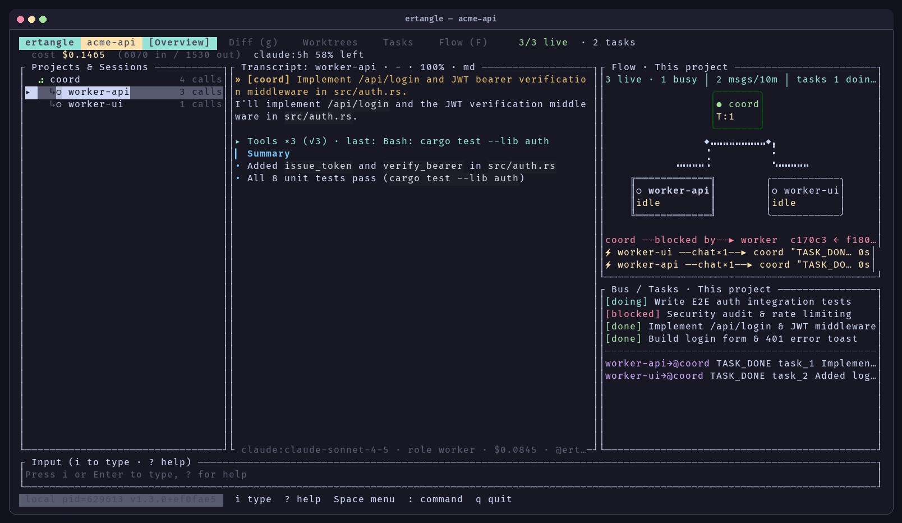
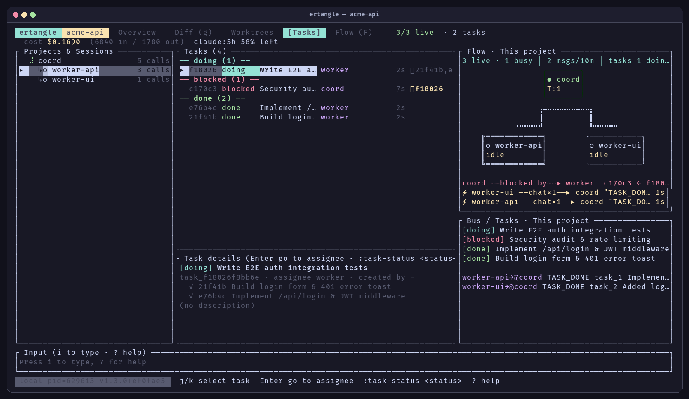
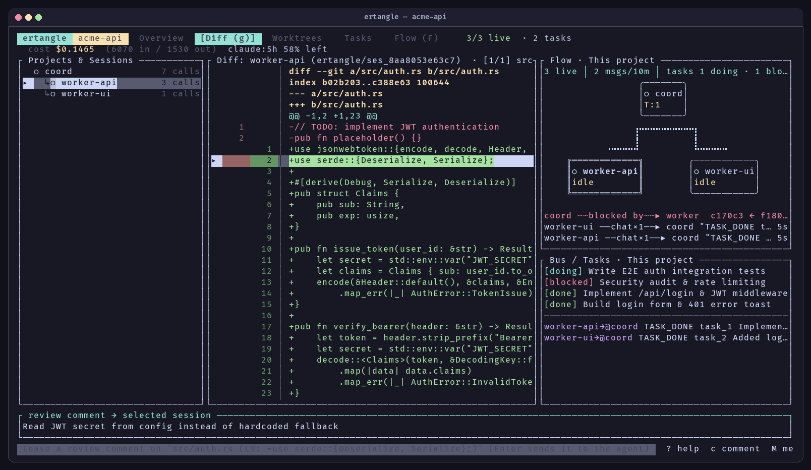
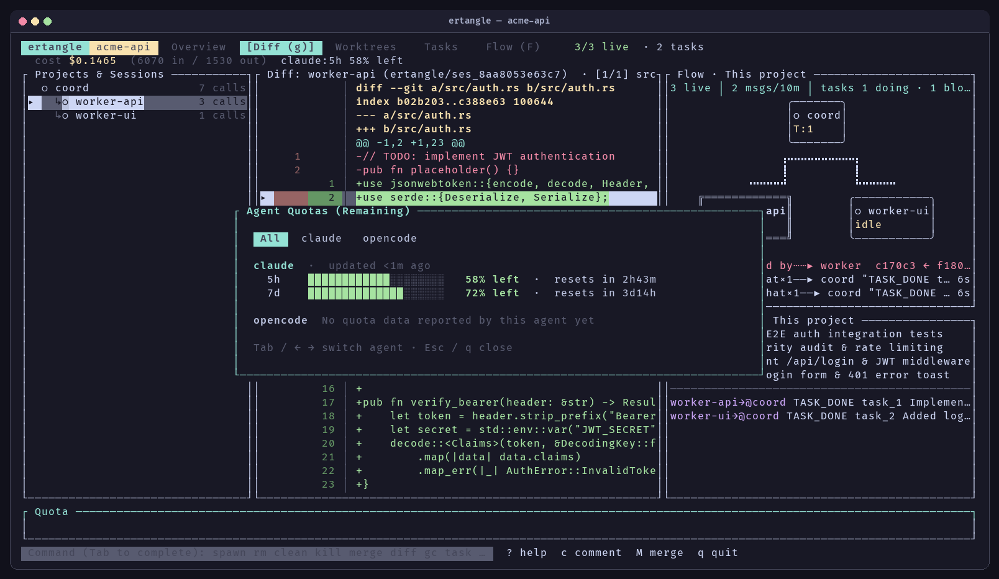

# ertangle — Terminal-Native Multi-Agent Development Environment

[English](README_EN.md) | [繁體中文](README.md)

> **Run multiple coding agents concurrently on the same git repository, communicating autonomously and collaborating safely inside your terminal.**

`ertangle` is a terminal-native orchestrator and development environment for modern coding agents (such as **OpenCode**, **Claude Code**, **Codex**, and **Antigravity**). Each agent operates in an isolated Git Worktree, communicates with peers across an MCP message bus and task board, and allows developers to inspect changes, conduct line-by-line code reviews, and merge branches safely through a keyboard-driven TUI.

---

## Screenshots & Demo

https://github.com/user-attachments/assets/4e86a5cd-e9fb-48d6-a9c8-f78826417eab



<details>
<summary>More Screenshots (Task Board, Inline Diff Review, Quota Monitor)</summary>

### Shared Task Board with Dependencies (`Tasks` tab)
Supports `depends_on` prerequisites; blocked tasks automatically unblock and wake their assignees once prerequisites complete.



### Git Diff & Inline Review Comments (`Diff` tab)
Inspect colored diffs for each worker's isolated worktree, press `c` on any line to send a review comment back to the agent, and press `M` to merge safely.



### Agent Quota Monitor (`:quota`)
Real-time 5h / 7d quota tracking and reset countdowns across agents.



</details>

---

## Why ertangle? (Terminal-Native vs. Heavy Desktop GUI IDEs)

Instead of heavy desktop GUI or Electron-based IDEs, `ertangle` embraces a terminal-native, daemon-separated architecture: bringing multi-agent orchestration, worktree isolation, and real-time code review directly into your terminal workflow—ultra-lightweight (`< 20 MB`), frictionless over SSH, and instantly accessible via mobile web:

| Differentiator | How ertangle does it |
| --- | --- |
| **Ultra-Lightweight & Fast** | Written in Rust + Ratatui; resident daemon memory footprint `< 20 MB`; instant launch; flawless performance over remote SSH |
| **Resident Daemon Architecture** | The daemon manages agent child processes, message bus, task boards, and worktree states; the TUI is a detachable, re-attachable interface |
| **Zero Conflicts via Isolation** | Each agent session automatically operates in its own `git worktree` and isolated branch (`ertangle/<session>`) |
| **Native Protocols with Zero Wrapper Overhead** | Prioritizes official structured protocols (ACP / stream-json / app-server); gracefully falls back to PTY pass-through if unavailable |
| **Structured Agent Collaboration** | Automatically injects an MCP server into agents, enabling them to message peers, delegate tasks, broadcast status, and wait for events |
| **Keyboard & Script Driven** | Full TUI keybindings, Helix-style which-key menu, `:` command-line, and a comprehensive, feature-complete `ertangle` CLI |

---

## Supported Agents & Protocols

Each agent communicates via its **official, native structured interface without external dependencies**:

| Agent | Native Protocol | Default Launch Command | Transport | Status & Capabilities |
| --- | --- | --- | --- | --- |
| **OpenCode** | ACP | `opencode acp` | `acp` | ✅ Full bidirectional structured mode (streaming, tool calls, permission forwarding, MCP injection) |
| **Antigravity** | ACP | `agy acp` | `acp` | ✅ Full bidirectional structured mode (ACP dialect compatible, MCP injection) |
| **Claude Code** | stream-json | `claude -p --input-format stream-json --output-format stream-json --verbose` | `stream-json` | ✅ Token streaming, tool calls, cost statistics, 5h/7d quota tracking, MCP injection, granular permission forwarding |
| **Codex** | app-server | `codex app-server` | `app-server` | ⚠️ Handshake & thread verified; sending turns requires `codex login` on the local machine |
| **Universal Fallback** | PTY | Interactive agent CLI | `pty` | ✅ Automatically falls back to PTY pass-through when native protocols are missing or uninstalled |

> [!NOTE]
> - **Codex Authorization**: `codex app-server` protocol is fully implemented, but running turns requires a valid OpenAI login. If unauthorized, the session transitions to `failed` and prompts the user to run `codex login`.
> - **PTY Limitation**: In PTY mode, full-screen TUI outputs are stripped of ANSI escape sequences on a best-effort basis. Native structured protocols are strongly recommended.
> - Detailed verification logs and tested agent versions are available in [`docs/VERIFICATION.md`](docs/VERIFICATION.md); architecture design specs are in [`docs/DESIGN.md`](docs/DESIGN.md).

---

---

## Migrating from termade

This project has been renamed from `termade` to `ertangle`. When upgrading, note the following compatibility and migration details:

- **Stop the old daemon**: Stop the running `termade` daemon before launching `ertangle` for the first time (`termade shutdown` or terminate the process).
- **Config and state directories**: On first run, `~/.config/termade` and `~/.local/state/termade` are moved automatically to `~/.config/ertangle` and `~/.local/state/ertangle` if the new directories do not exist yet.
- **Project config**: Repo-local `.termade/config.toml` is still read as a fallback until v1.0, but should be renamed to `.ertangle/`.
- **Environment variables**: `TERMADE_*` environment variables remain accepted as fallbacks until v1.0. Please migrate to `ERTANGLE_*`.
- **Reinstall skills**: Run `ertangle skill install` to reinstall the agent skill (`ertangle skill uninstall` also removes the legacy `termade-ade` skill).
- **Git branches**: Existing `termade/*` branches are untouched.

## Quick Start

### 1. Installation

**Option 1: Download a prebuilt binary** (from [Releases](https://github.com/single9/ertangle/releases/latest); Linux x86_64 / arm64 and macOS arm64 / x86_64 / universal)

```bash
# Linux x86_64 shown; swap the asset name for other platforms (ertangle-linux-arm64, ertangle-macos-arm64, ...)
curl -fsSL https://github.com/single9/ertangle/releases/latest/download/ertangle-linux-x86_64.tar.gz | tar -xz
install -m 755 ertangle-linux-x86_64 ~/.local/bin/ertangle
```

**Option 2: Install directly from git** (requires a Rust toolchain)

```bash
cargo install --git https://github.com/single9/ertangle

# Pin a specific version
cargo install --git https://github.com/single9/ertangle --tag v1.0.0
```

**Option 3: Build from source**

```bash
git clone https://github.com/single9/ertangle && cd ertangle
cargo install --path .        # installs to ~/.cargo/bin
# or use the Makefile to install to ~/.local/bin/ertangle
make install
```

`make install` also creates the short alias `ert` (a symlink to `ertangle`). With `cargo install`, add it yourself: `ln -s ~/.cargo/bin/ertangle ~/.cargo/bin/ert` or `alias ert=ertangle` in your shell.

**Shell completions** (bash / zsh / fish, with dynamic session label completion)

```bash
make install-completions      # run from the source checkout; detects your SHELL
# or generate manually: ertangle completions <bash|zsh|fish>
```

### 2. Launching Your First Agent Session

Inside any Git repository directory:

```bash
ertangle
```

- If the daemon is not already running, `ertangle` **automatically launches the daemon in the background** and starts the TUI.
- In the TUI, press **`n`** to spawn a new agent. Select the agent (e.g., `opencode`), choose a model, and type your prompt:
  ```
  Fix all failing unit tests and resolve any compiler errors
  ```
- The agent starts working inside its dedicated worktree (`ertangle/session-xxx`). Watch live Markdown streaming in the Overview tab, switch to the Diff view to inspect modifications, and merge safely with one keypress.

---

## Walkthrough: Coordinator + Worker Multi-Agent Collaboration

For medium-to-large features spanning multiple modules, you do not need to manually juggle multiple terminal windows. In `ertangle`, you can spawn a **Coordinator** session that decomposes requirements, schedules tasks with dependencies on the shared board, and spawns multiple isolated **Worker** sessions in dedicated Git Worktrees—while you review and merge everything from a single TUI.

### Scenario: Building JWT Authentication (Backend API + Frontend UI + Integration Tests)

#### Step 1: Launch the Coordinator (Choose Any Method)

**Method A: Interactive TUI Spawn (Recommended)**
1. Press **`n`** in the TUI and select an agent (e.g., `claude` or `opencode`).
2. In the prompt input step, press **`Ctrl-R`** to switch the role to **`coordinator`** (leave Worktree off via `Ctrl-W` so the coordinator stays on the main checkout).
3. Enter the goal prompt:
   ```text
   Act as Coordinator to deliver the "JWT Login Authentication" feature:
   1. Use ertangle_task_create to create three tasks:
      - T1: Implement /api/login endpoint and JWT middleware in backend
      - T2: Build login form and error handling in frontend
      - T3: Write end-to-end integration tests (set depends_on to wait for T1 and T2)
   2. Use ertangle_spawn to launch two worktree-isolated workers (worker-backend and worker-frontend) in parallel for T1 and T2.
   3. Call ertangle_wait to await their TASK_DONE reports, then assign or wake a worker to complete T3.
   ```

**Method B: One-Line TUI Command**
```text
:spawn --role coordinator claude:sonnet "Decompose the JWT login feature, create tasks on the board, and spawn two worktree workers for backend and frontend in parallel."
```

**Method C: Launch a Built-in Playbook**
```text
:playbook coord-review Implement JWT login authentication across backend and frontend
```
(Or press `Space s b` to pick from `coord-review`, `tdd-pair`, `dual-review`, or your custom playbooks).

---

#### Step 2: Watch Autonomous Multi-Agent Execution in the TUI

Once submitted, the agents coordinate over the MCP bus automatically:

```
[Coordinator: coord] (main checkout, planning & orchestration)
   ├── 1. Calls ertangle_task_create (T1, T2 = todo; T3 = blocked via depends_on)
   ├── 2. Calls ertangle_spawn to launch isolated workers
   │
   ├─► ↳ [worker-backend]  (branch @ertangle/ses_a1 · .ertangle/wt/ses_a1)
   │      ├── Calls ertangle_task_update(T1, status="doing")
   │      ├── Edits src/auth.rs and runs unit tests
   │      ├── Calls ertangle_task_update(T1, status="done")
   │      └── Calls ertangle_send(to="coord", "TASK_DONE task_1 Implemented /api/login and JWT middleware") and stops immediately
   │
   └─► ↳ [worker-frontend] (branch @ertangle/ses_b2 · .ertangle/wt/ses_b2)
          ├── Calls ertangle_ask(peer="worker-backend", "QUERY: What is the exact JSON schema for 401 errors?")
          ├── Edits web/login.ts and form validation
          ├── Calls ertangle_task_update(T2, status="done")
          └── Calls ertangle_send(to="coord", "TASK_DONE task_2 Added login form and error handling") and stops immediately
```

What you see in the TUI:
- **Left Sessions Pane**: Displays the parent-child hierarchy (`↳ worker-backend [worker]`), worktree branch names, and active tool indicators.
- **Center Tasks View (press `Tab`)**: Shows T1 and T2 in `doing`. As soon as both T1 and T2 reach `done`, the daemon automatically unlocks T3 from `blocked` (`⧗`) to `todo` and wakes its assignee.
- **Token-Efficient Protocol**: Inter-agent messages follow a strict English protocol (`TASK_DONE`, `TASK_BLOCKED`, `QUERY:`, `ANSWER:`) with zero pleasantries—once a worker sends `TASK_DONE`, it terminates its turn immediately without wasting tokens on courtesy replies.

---

#### Step 3: Review Diffs, Resolve Conflicts & Merge Safely

1. **Inspect & Comment on Diffs**: Select `worker-backend` with `j` / `k` and press **`Tab`** to open the **Diff View**.
   - Jump between files with `(` / `)` and fold reviewed files with `Enter`.
   - Press **`c`** on any line to leave an inline review comment (e.g., "Read token expiration from config")—the comment is routed back to the worker to fix.
   - Press **`X`** (`:discard`) on any unwanted debug hunk to revert it directly without spending another agent turn.
2. **Merge & Delegate Conflicts**:
   - Press **`M`** (`:merge`) on `worker-backend` to auto-commit and merge into `main`.
   - Select `worker-frontend` and press **`M`**. If both workers touched a shared config file causing a conflict, run **`:merge --resolve`** (or press `Space g r`): `main` stays clean while conflict markers are placed inside `worker-frontend`'s isolated worktree, prompting the worker to resolve the conflict and re-verify tests.
3. **Clean Up & Export Report**:
   - Press **`G`** (`:gc`) to clean up completed and merged worktrees.
   - Run **`:export`** on the coordinator session to export a full Markdown report (hierarchy, task summary, costs, and transcripts) to `.ertangle/exports/` and copy it to your system clipboard via OSC 52, ready to paste into a GitHub PR.

---

## Core Features & Workflow

### 1. Worktree Isolation & Review Loop

- **Dedicated Worktree & Branch**: Each session operates inside an independent `git worktree` and `ertangle/<session>` branch, eliminating file conflicts.
- **Real-Time Color Diff**: Press `Tab` in the TUI to switch to the Diff view; navigate hunks with `{` / `}`, jump between files with `(` / `)`, fold/unfold individual files with `Enter` (or `v`), and revert a single hunk or entire file with `X` (or `:discard`).
- **Inline Review Comments**: Press `c` on any diff line to submit inline feedback (e.g., "Add boundary checks here"). The comment is routed back to the agent for automated revision.
- **Safe Merge & Conflict Resolution**: Press `M` or run `ertangle merge`. The system runs pre-flight safety checks (supports global `pre_merge_command` gate verification), commits uncommitted worktree changes automatically, and merges into the main branch. On conflicts, use `:merge --resolve` (or Which-key `Space g r`) to keep conflict markers isolated in the worktree while keeping `main` clean, delegating conflict resolution to the agent.
- **Garbage Collection (GC)**: Press `G` or run `ertangle gc` to clean up merged and completed worktrees safely without deleting unmerged work.

### 2. Multi-Agent Bus & Task Board (MCP)

Every structured agent session is automatically injected with a stdio MCP server containing **16 collaboration tools**:

| Category | Tool Name | Description |
| --- | --- | --- |
| **Self & Peers** | `ertangle_whoami`, `ertangle_peers` | Inspect own session ID, branch, worktree path, and peer agent details |
| **Messaging** | `ertangle_send`, `ertangle_inbox`, `ertangle_wait`, `ertangle_ask` | Send direct/broadcast messages, non-blocking inbox reads, blocking wait, synchronous Q&A |
| **Task Board** | `ertangle_task_list`, `ertangle_task_create`, `ertangle_task_update` | Create tasks, assign owners, specify `depends_on` prerequisite dependencies; pass `report` to `ertangle_task_update` (`done`/`blocked`) to atomically send `TASK_DONE` / `TASK_BLOCKED` to the parent session |
| **Spawning & Output** | `ertangle_spawn`, `ertangle_artifact_share`, `ertangle_status` | Spawn sub-agents (supports `task_title` / `task_id` to atomically create or bind a board task), share artifacts (files, PR links), broadcast status summaries |
| **Interaction & Approval** | `ertangle_question`, `ertangle_approve` | Ask interactive single/multi-select questions, forward tool permission approvals |
| **Git Operations** | `ertangle_diff`, `ertangle_merge` | Query branch diff vs. main branch (supports `stat_only`, `paths`, `max_lines`, and auto-folds giant lock/generated files like `package-lock.json`, `Cargo.lock`, `*.Designer.cs`, `*ModelSnapshot.cs`), request worktree merge |

- **Unread Nudge on Idle**:
  - Direct messages and broadcasts sent to busy agents are buffered in their mailbox **without interrupting active turns**.
  - Once the recipient finishes its turn and returns to `idle` (and pending prompt queues are drained), buffered unread messages are consolidated into a single gentle reminder. Each message is nudged **only once**.
  - Messages already retrieved via `ertangle_wait` / `ertangle_ask` or sessions exceeding budget limits are not nudged.
- **Task Dependencies**:
  - Tasks created with `--depends-on <id>` remain `blocked` until all prerequisites are marked `done`.
  - Once unlocked, the task transitions to `todo` and notifies the assigned agent automatically.
- **Mailbox Fallback**: All messages are simultaneously written to `<repo>/.ertangle/mailbox/<session>.jsonl`.

### 3. Quota Tracking, Intelligent Handoff & Session Resume

- **Quota Monitoring**:
  - Parses real-time quota data reported by agents (Claude 5-hour / 7-day rate limit windows and reset countdowns; Codex rate limits).
  - Title bar displays the tightest window (`≥ 70%` yellow, `≥ 90%` red). Run `:quota` for detailed status.
- **Intelligent Handoff**:
  - When an agent runs out of quota or rate-limited, or when requested manually (`:handoff <agent> [note]`):
  - The previous agent stops, and uncommitted worktree changes are committed automatically;
  - The daemon synthesizes a comprehensive briefing (goals, tasks, last output, full git diff);
  - The successor agent **takes over the exact same worktree and branch**;
  - Messages sent to the old session ID/label are **automatically forwarded to the successor**.
- **Session Resume**:
  - If an agent process crashes or the daemon restarts, press `Space s r` or run `ertangle resume <session> [prompt]` to resume the **exact same conversation**.
  - Leverages native resume mechanisms (Claude `--resume`, Codex `thread/resume`, ACP `session/load`), preserving session ID, transcript, and branch.

### 4. Resource Control, Budgeting & Idle Sleep

- **Cost & Token Limits**:
  - Configure per-session USD limits (`session_usd`), parent-child tree budget (`tree_usd`), and token caps (`session_tokens`), as well as maximum sub-agent depth.
  - When reaching threshold (default 80%), visual warnings trigger. Exceeding limits halts execution and holds pending prompts until budget is increased via `:budget <amount>`.
- **Idle Process Suspension (Sleep/Wake)**:
  - Press `z` or run `ertangle sleep <session>` to send `SIGSTOP`, freezing idle agent processes and freeing CPU. Press `z` or send a message to dispatch `SIGCONT` and wake them up.

### 5. Permission Policy & Rule Engine

- Cross-agent unified flag `--permission <ask|auto|bypass>`:
  - `ask`: Tool calls require manual approval in the TUI (`a` allow once / `A` always allow / `d` deny).
  - `auto` (default): Safe operations are approved automatically.
  - `bypass`: Skips permission confirmation.
- **Policy Engine**: Configured via `~/.config/ertangle/policy.toml` and `.ertangle/policy.toml` using `deny` (blacklist) → `allow` (whitelist) → session policy order.
- **Claude Granular Approval Forwarding (T33)**: Mounts `--permission-prompt-tool mcp__ertangle__ertangle_approve --permission-prompts host` in non-`bypass` mode, enabling Claude's tool invocations to be filtered by `policy.toml` and approved interactively in TUI `ask` mode.
- **Comprehensive Secret Redaction (T33)**: All MCP tool outputs (including `ertangle_inbox`, `ertangle_wait`, `ertangle_ask`, `ertangle_diff`, etc.) and event logs automatically sanitize sensitive credentials (`sk-...`, `ghp_...`, `AKIA...`, etc.) into `<REDACTED>` before delivery.

### 6. Remote Connections, Tailscale Integration & Auto-Reconnect (T28)

- **Automatic Tailscale Detection**:
  - Start daemon with `ertangle daemon --listen tailscale` to auto-resolve your machine's peer-to-peer Tailscale IPv4 address via `tailscale ip -4`.
  - Automatically generates and securely stores auth tokens at `~/.local/state/ertangle/remote.token` (file permission `0600`).
- **Connection Info Quick Look**:
  - Run `ertangle daemon info` to print local and Tailscale addresses, token path, and copy-paste connection commands.
- **Resilient Auto-Reconnect**:
  - When laptops wake from sleep, networks switch, or brief disconnects happen, the TUI automatically reconnects in the background with exponential backoff.
  - Reconnects using `Request::Hello { since, epoch, token }` to seamlessly resume state and backfill missed events without interruption.

### 7. Multi-Host Aggregation in TUI (T29)

- **Unified Multi-Machine Dashboard**:
  - Configure `[remotes]` in `config.toml` or launch with `ertangle --remote workstation:7420 --remote gpu-box:7420`.
  - View, monitor, and interact with agent sessions running across multiple machines from a single unified TUI dashboard.
- **Transparent Routing & Filtering**:
  - Sessions are tagged with colored host badges (`[workstation]`, `[gpu-box]`).
  - Sending prompts, reviewing diffs, and approving tool executions are automatically routed to the owning host.
  - Switch host views anytime using `:host <target>` or `:host all`.

### 8. Web Interface & Mobile PWA (T30)

- **Mobile Review On The Go**:
  - Step away from your desk without losing review flow. Enable it directly from the TUI settings panel (`:settings` or `Space ,`) or by typing `:web on [addr]` (or via CLI `ertangle daemon --web tailscale`).
  - A clean **Unicode QR Code** can be displayed in your terminal with `:web qr` or `Space w` for instant camera scanning on mobile phones.
- **Zero-Dependency Native HTTP / WebSocket**:
  - Built directly into the single binary with pure Rust standard networking—no Node.js, npm, or heavy async dependencies required.
- **Thumb-Friendly Native Mobile PWA**:
  - **Approval Banner & Interactive Questions**: Pops up immediately when agents request tool execution permissions (Allow / Always / Deny) or ask interactive questions (single/multi-select options or freeform text).
  - **Conversational Turns**: Restructures raw transcripts into clean turns, grouping messages, thought folds (`⋯`), and tool call results.
  - **Live Thinking Animation**: Active reasoning blocks display an animated pulse indicator (`⋯ 思考中`) with the latest thought preview, completely emoji-free.
  - **Slash Command Palette & Shell Execution**: Type `/` to open the command palette; type `!<cmd>` or `/sh <cmd>` to run shell commands in the session's workspace.
  - **Folded Ended Sessions & Pruning**: Automatically folds ended sessions at the bottom of the sidebar, with a "Prune Ended" button and archived session drawer.
  - **Full Markdown & Inline Image Previews**: Clean typography for `h1`–`h6` headings, preserved ordered list numbering, indented bullets, quotes, code blocks with a one-tap copy button, and `` inline image previews with strict origin/path validation.
  - **Text & Image File Previews**: Tap interactive file pills to preview text/code files (with line jumping and highlights) or view images directly.
  - **Git Diff Review & One-Tap Merge**: Review branch diffs and merge back to main directly from your phone.

---

## TUI User Guide

### 1. Layouts and Views

- **Layout Modes**: On wide terminals (`>= 130` cols), automatically expands to a "Three-pane" layout (`Projects & Sessions` on the left + Center + right split with `Flow` graph on top and `Bus / Tasks` below). Press `L` to pin and cycle through "Two-pane", "Tabs" (Top Session Tabs + Center), and "Three-pane"; run `:layout auto` to restore adaptive sizing, and press `b` to toggle the right pane between `Flow + Bus` and `Project`.
- **Center Views**: Press `Tab` (or `F` for Flow) to cycle across the main views:
  1. **Overview**: Real-time streaming transcript with Markdown rendering (headers, lists, tables, code blocks).
  2. **Diff**: Real-time colored Git Diff view with inline review support.
  3. **Worktrees**: List of all managed Git Worktree paths and disk states.
  4. **Tasks**: Collaborative task board grouped by status (doing, review, todo, blocked, done) with dependency markers (`⧗`). Press `Enter` to jump to the assignee's session.
  5. **Flow**: Orthogonal 90-degree node graph with packet animation showing real-time Coordinator/Worker topology and message flow.
- **Version Identification**: Both `ert --version` and the TUI status bar display `v<semver>+<short_hash>` for easy build identification.

### 2. Keybindings Cheat Sheet

#### Navigation, Menu & Core Actions

| Key | Action |
| --- | --- |
| `Space` | Open **Which-key menu** (`s` session, `g` git, `v` view, `m` message, `?` help) |
| `:` or `/` | Open **Command-line** (supports `Tab` completion) |
| `!` | Enter **Shell Command mode** (run shell commands directly in the selected session's workspace `!<cmd>`) |
| `n` | Create new session (select Agent, Model, input Prompt; supports `Ctrl-R` for Role, `Ctrl-W` for Worktree, `Ctrl-F` for Effort) |
| `i` / `Enter` | Focus input box to send prompt (supports `@peer` and `#channel` routing) |
| `j` / `k` or `↑` / `↓` | Select sessions and collapsible groups in `Projects & Sessions`; move line cursor in Diff; select task in Tasks view |
| `l` / `→` / `h` / `←` / `Space` | Expand (`l` / `→`) or collapse (`h` / `←`) ended (`▸ Ended (N)`) and other-project rows in the sidebar (`Space` toggles) |
| `[` / `]` | Jump to previous / next session |
| `Ctrl-K` | **Jump-Anywhere**: Fuzzy search and jump to any session |
| `Space ,` (or `:settings`) | Open **Settings panel** (toggle default Agent, Model, Effort, Worktree, Web version support, etc.) |
| `Space w` (or `:web qr`) | Display **Web version URL & QR Code** popup (scan and connect instantly) |
| `q` / `Q` | `q` exit TUI (daemon and agents keep running); `Q` stop daemon (same as `:shutdown`) |

#### Transcript, Search & Clipboard

| Key | Action |
| --- | --- |
| `t` | Toggle transcript mode: Markdown rendering ↔ Raw text |
| `T` (or `:thoughts`) | Toggle agent thought lines (`⋯`, folded by default with animated live spinner) |
| `O` (or `:tools`) | Fold / unfold tool calls (consecutive successful calls are folded by default) |
| `f` (or `:find <text>`) | **Incremental search** in transcript or diff (`Enter`/`↓` next, `↑` previous, `Esc` exit) |
| Mouse Drag | Select text in center pane; release to copy via **OSC 52** |
| `Y` (or `/copy`) | Copy current center pane content (excluding borders and sidebars) |
| `F2` | Toggle mouse capture mode (disable to use native terminal selection, or use `Shift`+Drag) |
| `PgUp` / `PgDn` | Scroll transcript up / down (pauses auto-scroll) |
| `Home` / `End` | Jump to top / jump to bottom and resume auto-following (`▼ follow`) |
| `P` | Toggle project scope: Current project only (`here`) ↔ All projects (`all`) |

#### Prompt Input & Queuing

| Key / Syntax | Description |
| --- | --- |
| `!<cmd>` | **Execute Shell Command in Session Workspace** (runs directly without agent intervention, e.g. `!cargo test`; or press `!` in Normal mode) |
| `@filename` | **Fuzzy file attachment**: Type `@` to fuzzy search repo files; auto-attaches text (up to 256 KB) or images (up to 5 MB) |
| `Ctrl-V` | Paste image from system clipboard (requires `wl-paste` or `xclip` on Linux) |
| Drag & Drop | Drag files from file manager into terminal to auto-insert `@path` |
| `Shift-Enter` / `Ctrl-Enter` / `Ctrl-J` | Native newline in prompt input (via Kitty keyboard enhancement with `Ctrl-J` fallback; expands up to 8 lines) |
| `Option` / `Cmd` editing shortcuts | Supports macOS / readline cursor & delete shortcuts (`Option+Left/Right`, `Option+Backspace` / `Ctrl-W`, `Option+Delete`, `Cmd+Left/Right/Backspace`, `Ctrl-K`) |
| Stopped-session send prompt | Confirms before sending a prompt to an exited, failed, or sleeping session, automatically resuming/waking it (preserving draft on cancel) |
| `Alt-Enter` | **Queue prompt**: If session is busy, queues in daemon to send automatically when idle |
| `↑` / `↓` | Cycle command and prompt input history (persisted across restarts) |

#### Spawn Mode Shortcuts (Creating Sessions)

| Key | Description |
| --- | --- |
| `Ctrl-R` | Cycle role: `worker` ↔ `coordinator` ↔ `reviewer` (customizes injected prompt per role) |
| `Ctrl-W` | Toggle dedicated Git Worktree branch |
| `Ctrl-E` | Cycle permission policy: default (config) ↔ `ask` ↔ `auto` ↔ `bypass` |
| `Ctrl-F` | Cycle reasoning effort: default ↔ `low` ↔ `medium` ↔ `high` ↔ `max` |

#### Review, Git & Session Lifecycle

| Key | Action |
| --- | --- |
| `{` / `}` | (Diff view) Jump to previous / next hunk (`@@`) |
| `(` / `)` (or `<` / `>`) | (Diff view) Jump to previous / next file (`diff --git`) |
| `Enter` / `v` | (Diff view) Fold / unfold the file at cursor |
| `X` (or `:discard`) | (Diff view) Revert the hunk or entire file at cursor (press `X` again or `:discard!` to confirm) |
| `c` | (Diff view) Leave review comment on cursor line and route back to agent |
| `M` | Safely merge selected session's worktree branch into main (`:merge --dry-run` to preview, `:merge --resolve` to delegate conflicts) |
| `G` | Clean up (GC) completed and merged worktrees |
| `z` | Toggle session pause (`SIGSTOP`) and wake (`SIGCONT`) |
| `x` | Interrupt current agent turn (Cancel) |
| `K` | Force kill selected agent child process (Kill) |
| `a` / `A` / `d` | Permission request: Allow once / Always allow for this turn / Deny |

### 3. TUI Command-Line (`:command`)

Press `:` to open the command line with `Tab` completion:

- `:spawn [--role <role>] <agent>[:model] <prompt>` — Spawn a new agent session (e.g., `:spawn --role coordinator claude:opus "plan architecture"`)
- `:playbook [<name> <goal>]` — Launch a multi-agent team playbook (e.g., `:playbook tdd-pair implement login`); no args opens the picker (also `Space s b`)
- `:export [path]` — Export the selected session (and its sub-session tree) as Markdown to `.ertangle/exports/<label>-<timestamp>.md` and copy it via OSC 52
- `:exec <cmd>` (or `:sh`) — Execute a shell command in the session workspace directly (bypass agent; or type `!<cmd>`)
- `:handoff <agent> [note]` — Hand over current session to another agent
- `:resume [prompt]` — Reconnect to an exited session and continue dialogue
- `:restart` — Re-execute daemon and automatically resume in-flight sessions
- `:merge [--dry-run] [--resolve] [--strategy merge|squash|rebase]` — Merge session branch back to main
- `:discard` / `:discard!` — (Diff view) Revert the hunk or entire file at cursor
- `:queue` / `:unqueue` / `:queue clear` — View, pop, or clear prompt queue
- `:rm` / `:clean` — Remove an exited session / purge all finished sessions
- `:prune` — Archive merged and ended worker sessions and remove their worktrees
- `:budget <amount>` — View or increase session USD budget cap
- `:quota` — Display rate limit windows and reset countdowns for all agent accounts
- `:task <title>` / `:tasks` — Create task / switch to Tasks board view
- `:task-status <todo|doing|blocked|review|done>` — Update status of selected task
- `:host <target|all>` — Filter sessions by host in multi-host mode (T29)
- `:remote` — Display remote connection details, Tailscale IP, and Web version URL
- `:notify on|off|test` — Toggle desktop notifications or send a test alert
- `:shutdown` — Shut down daemon and all running agents (requires `:shutdown!` to confirm)

---

## CLI Reference

`ertangle` provides a comprehensive CLI mirroring TUI capabilities:

```bash
# Session Management
ertangle sessions [--json]                         # List all sessions (alias: ertangle peers)
ertangle whoami [--session <id>] [--json]          # Show current session metadata
ertangle spawn --kind <agent> [--label <label>] [--worktree] [--prompt <prompt>]
ertangle resume <session-or-label> ["prompt"]      # Resume an exited session
ertangle restart                                   # Restart daemon and auto-resume in-flight sessions
ertangle exec <session> <command...>               # Run shell command in session workspace (alias: ertangle sh)
ertangle handoff <session-or-label> --to <agent> [--note "Handoff notes"]
ertangle sleep <session> ; ertangle wake <session>  # Suspend / wake agent processes
ertangle cancel <session> ; ertangle kill <session> # Interrupt turn / kill process
ertangle rm <session> [--force]                    # Remove exited session record
ertangle prune [--project <path>]                  # Archive merged & ended workers and clean worktrees

# Multi-Agent Playbooks & Collaboration Reports
ertangle playbook <name> "<goal>"                  # Launch a whole team from a built-in or custom playbook
ertangle export <session> [--tree] [--diff] [-o <path>] # Export a Markdown report (-o omitted prints to stdout)

# Prompts & Queue
ertangle prompt [--queue] <session-or-label> "prompt text"
ertangle queue <session-or-label> [--clear]        # View or clear prompt queue

# Worktree & Code Review
ertangle worktrees                                 # List all managed git worktrees
ertangle diff <session-or-label> [--stat] [--max-lines <n>] [paths...] # View git diff for a session (supports stats, path filters, and lock/designer folding)
ertangle review <session-or-label> --location <file>:<line> "Review comment"
ertangle merge <session-or-label> [--dry-run] [--resolve] # Merge session branch back to main
ertangle pr <session-or-label> --title "PR title"  # Create GitHub Pull Request via gh
ertangle gc [--session <id>]                       # Clean up merged worktrees safely

# Polyglot Agent Efficiency Tools (Rust / Node / Vite / .NET Core / Python)
ertangle check [--cwd <dir>] [--stack <auto|rust|node|dotnet|python>] [--quick] [--max-lines <n>] [--json] # Low-token build, type, and test verifier
ertangle outline [paths...] [--max-depth <n>] [--json] # Extract symbol outlines and exact line ranges (L<start>-L<end>)
ertangle dev start [--cwd <dir>] [--port <port>] [--timeout-secs <n>] [--json] [-- <cmd...>] # Non-blocking background dev server with auto free port
ertangle dev status [--cwd <dir>] [--json]         # Check status of the managed dev server in the workspace
ertangle dev stop [--cwd <dir>] [--json]           # Stop the managed dev server process group

# Cross-Agent Messaging & Tasks
ertangle send <session-or-label> "message content" # Send message to target agent
ertangle inbox [--session <id>]                    # Read session inbox
ertangle tasks                                     # List tasks and dependency states
ertangle task "Task title" [--assignee <label>] [--depends-on <id>]
ertangle task-update <id> --status <status>        # Update task status (todo/doing/blocked/review/done)

# Cost, Quota & Event Replay
ertangle quota [--json]                            # Query account quotas and reset times
ertangle cost [--json]                             # Breakdown token and USD spend
ertangle budget <session-or-label> <amount>        # Set or raise budget cap
ertangle replay [--since <seq>] [--json]           # Audit and replay events.jsonl

# Remote Daemon, Multi-Host & Web Version Support
ertangle daemon --listen tailscale                 # Start daemon bound to Tailscale WireGuard IP
ertangle daemon --listen 127.0.0.1:7420            # Start daemon listening on TCP (auto-generates token)
ertangle daemon --web tailscale                    # Start Web version and print terminal QR code (default port 7421)
ertangle daemon --web tailscale --web-port 8080    # Start Web version with custom port (8080)
ertangle daemon info                               # Print current Tailscale IP, token, and connection examples
ertangle --remote tailscale                        # Connect to local Tailscale daemon
ertangle --remote workstation:7420 --remote gpu:7420 # Aggregate multiple remote hosts into a single TUI
ertangle completions <bash|zsh|fish>               # Generate shell completion script
```

---

## Configuration & Environment Variables

### Configuration File: `config.toml`

`ertangle` merges global settings (`~/.config/ertangle/config.toml`) with project-level overrides (`<repo>/.ertangle/config.toml`):

```toml
[tui]
layout = "two"                    # Default layout: "two" | "three" | "tabs"
notify = ["bell", "command"]      # Notification methods: "bell" | "osc9" | "command"
notify_command = "notify-send ertangle \"$ERTANGLE_NOTIFY_TEXT\""
notify_min_turn_secs = 10         # Turns shorter than this threshold do not notify

[web]
# Web version settings (global only; can also be toggled in TUI :settings)
enabled = true                    # Enable Web version
port = 7421                       # Custom port: default 7421 (can also be specified in addr, e.g. "127.0.0.1:8080")
addr = "tailscale"                # Listen address: "tailscale" (auto-detect IP) | "127.0.0.1" | "0.0.0.0"

[remotes]
# Multi-host aggregation (T29)
workstation = { addr = "100.64.0.5:7420", token_file = "~/.config/ertangle/workstation.token" }
gpu-box = { addr = "100.64.0.8:7420" }

[limits]
session_usd = 5.0                 # Max USD budget per session
tree_usd = 15.0                   # Max USD budget for parent-child tree
warn_percent = 80                 # Warning threshold percentage
max_children = 5                  # Max concurrent child sessions per parent
max_depth = 3                     # Max sub-agent spawn hierarchy depth

[handoff]
warn_percent = 90                 # Warn with :handoff suggestion at 90% quota
auto = false                      # Automatically hand off on quota exhaustion (default false)
fallback = ["codex", "claude:sonnet"]

[collab]
instructions = true               # Inject ertangle collaboration rules into agent system prompt
extra = "Follow guidelines in CONTRIBUTING.md closely"

[playbooks.tdd]
# Built-in playbooks: coord-review, tdd-pair, dual-review. Same-name settings override built-ins,
# and enabled = false hides a built-in playbook.
description = "TDD team (Coordinator + Test Worker + Impl Worker)"
enabled = true
[[playbooks.tdd.sessions]]
label = "coord"
kind = "claude"
role = "coordinator"
prompt = "Coordinate the team to achieve: {{goal}}"
[[playbooks.tdd.sessions]]
label = "reviewer"
kind = "opencode"
role = "reviewer"
worktree = true

[git]
# Git & worktree settings (read only from global config for security)
pre_merge_command = "cargo test"       # Pre-merge validation command; non-zero exits abort merge
```

> [!TIP]
> If `<repo>/.ertangle/instructions.md` exists (up to 8 KB), its content is appended to the agent's system prompt during initialization.

### Environment Variables

| Variable | Default Value | Description |
| --- | --- | --- |
| `XDG_RUNTIME_DIR` | `/tmp/ertangle-$USER/` | Directory storing daemon Unix domain socket |
| `XDG_STATE_HOME` | `~/.local/state/` | Path for persistent events log (`$XDG_STATE_HOME/ertangle/events.jsonl`) |
| `ERTANGLE_LOG` | `warn` | Tracing filter level (e.g., `ERTANGLE_LOG=debug`) |
| `ERTANGLE_TOKEN` | — | Authentication token for remote daemon connections (use SSH tunneling for security) |
| `ERTANGLE_REMOTE` | — | Default remote daemon address (equivalent to `--remote`) |

---

## Development & Pre-commit Verification

To ensure local changes pass CI reliably, install the pre-commit hook or run one-command verification:

```bash
make setup-hooks   # Automatically installs .git/hooks/pre-commit
make pre-commit    # Auto-formats (fmt), runs clippy, and checks i18n catalogs
```

---

## Architecture & Reference Documents

- [`docs/DESIGN.md`](docs/DESIGN.md) — Architectural design, event synchronization protocols, state machines, and MCP specifications.
- [`docs/VERIFICATION.md`](docs/VERIFICATION.md) — Verification results, test suites, and real-world agent compatibility logs.
- [`docs/MAINTAINING.md`](docs/MAINTAINING.md) — Maintenance checklist for synchronizing keys, CLI commands, and protocols.
- [`docs/tickets/`](docs/tickets/) — Improvement tickets, refactoring, and architectural evolution.

---

## License

This project is licensed under the [MIT License](LICENSE).

---

## Acknowledgements

`ertangle` was inspired by [Orca](https://github.com/stablyai/orca) (MIT licensed); its full-handoff and review-loop concepts informed this design. This is an independent implementation and does not copy its code.

---

## Name Origin

The name `ertangle` (pronounced "er-tangle") combines ER (Einstein-Rosen bridge) and entangle, inspired by the Maldacena–Susskind ER=EPR conjecture (entanglement = Einstein-Rosen bridges). In `ertangle`, each agent lives in its own universe (a git worktree) and connects through entanglement (the MCP message bus). It is a sibling project of [erbridge](https://github.com/single9/erbridge).
